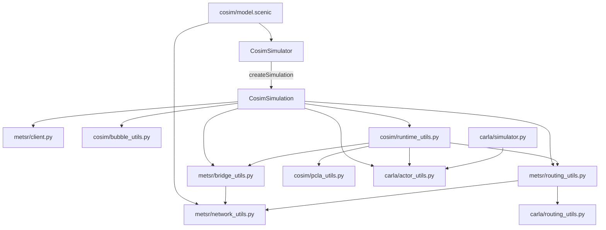

# Reviewing the CARLA-METS-R implementation

The implementation has one co-simulation backend, with shared CARLA mechanics and a separate METS-R protocol boundary. This guide describes the current file layout, the ownership rules that must survive future changes, and the checks used to review them.

## Simulator and simulation lifetimes

[cosim/simulator.py](../../src/scenic/simulators/cosim/simulator.py) defines exactly one `CosimSimulator` and one `CosimSimulation`. The package initializer and Scenic model import `CosimSimulator`; they do not define additional backends.

`CosimSimulator` owns reusable connections, the loaded CARLA world, Traffic Manager settings, network metadata, and configuration. Scenic calls its `createSimulation` method to create a `CosimSimulation` for each run. That run owns actors, pending admissions, native ownership, counters, snapshots, and cleanup. These two classes implement Scenic's existing `Simulator` / `Simulation` lifecycle.

All options use this execution path:

| Purpose | Existing constructor options |
| --- | --- |
| Maps and bubble | `carla_map`, `map_path`, `xml_map`, `bubble_size`, optional `network_metadata` |
| Connections | `address`, `carla_port`, `metsr_host`, `metsr_port`, `traffic_manager_port`, `timeout`, `metsr_sim_dir` |
| Timing | `timestep`, `sim_timestep`; individual runs cannot override the configured timestep |
| Visualization | `render`, `metsr_viz_port`, `metsr_render_freq` |
| Recording and diagnostics | `record`, `run_name`, `verbose` |

Rendering, recording, and statistics do not require alternate simulator classes or new feature switches.

## File responsibilities and dependencies

Helper modules sit directly under their owning simulator package and are named for their role. The old nested `cosim/utils` and `carla/utils` packages and ambiguous `cosim_utils` / `cosim_routing_utils` module names have been removed; internal imports use the current paths directly.



| File | Responsibility |
| --- | --- |
| [cosim/simulator.py](../../src/scenic/simulators/cosim/simulator.py) | Step ordering, direct client calls, actor membership, and controller decisions. |
| [cosim/bubble_utils.py](../../src/scenic/simulators/cosim/bubble_utils.py) | `BubbleTopology`, connected Scenic road selection, and intersections. |
| [cosim/runtime_utils.py](../../src/scenic/simulators/cosim/runtime_utils.py) | Native-pose spawn setup, boundary obstacles, preview display, diagnostics, route-state cleanup, and final actor teardown. |
| [cosim/pcla_utils.py](../../src/scenic/simulators/cosim/pcla_utils.py) | Current and legacy PCLA hooks, including protection of Scenic-owned vehicles during sensor cleanup. |
| [cosim/actions.py](../../src/scenic/simulators/cosim/actions.py), [scenarios.scenic](../../src/scenic/simulators/cosim/scenarios.scenic) | Scenario-facing actions and traffic scenario helpers. |
| [metsr/bridge_utils.py](../../src/scenic/simulators/metsr/bridge_utils.py) | Per-run native state, response identity matching, road ownership, admissions, pose acknowledgments, and completion validation. |
| [metsr/network_utils.py](../../src/scenic/simulators/metsr/network_utils.py) | Immutable XML metadata, lane mappings, connector topology, and derived indexes. |
| [metsr/routing_utils.py](../../src/scenic/simulators/metsr/routing_utils.py) | Native geometry queries, lane/connector projection, spawn and handback placement, destination routing, and `BubbleRoadSelection`. |
| [metsr/client.py](../../src/scenic/simulators/metsr/client.py), [server_utils.py](../../src/scenic/simulators/metsr/server_utils.py) | Wire requests and client lifecycle; server configuration and visualization support. |
| [carla/actor_utils.py](../../src/scenic/simulators/carla/actor_utils.py) | Blueprint compatibility, actor initialization, walker controllers, and property conversion shared by standalone CARLA and co-simulation. |
| [carla/routing_utils.py](../../src/scenic/simulators/carla/routing_utils.py), [coordinate_utils.py](../../src/scenic/simulators/carla/coordinate_utils.py), [global_route_planner.py](../../src/scenic/simulators/carla/global_route_planner.py) | CARLA geometry, coordinate conversion, and route planning. |

Native metadata and bridge helpers must import without CARLA or `cosim`. Optional METS-R routing uses CARLA but must not import `cosim`. Shared CARLA helpers must not depend on METS-R. Standalone CARLA and METS-R retain their own entry points.

## State and geometry ownership

`NetworkMetadata` copies input mappings and nested collections into read-only mappings, tuples, and frozensets. It builds the derived `carla_keys_by_lane`, `roads_by_scenic`, and `scenic_roads_by_native` indexes once. The Scenic model loads one metadata object for mapped spawn regions and passes it to the factory; each run references it through `metsr_state.metadata`.

Private vehicle IDs, road/connector ownership, admissions, authoritative segments, and native geometry query caches remain on the run's `METSRCosimState`. Loading metadata parses the XML once per call; there is no process-wide XML cache that hides file changes. Native lane indices exclude shoulders, road IDs can contain underscores, and connector IDs remain opaque.

The extra per-object lane cache has been removed. Spawn placement uses Scenic's existing `obj._lane`. Static bubble connectivity is represented by the frozen `BubbleTopology`: road/intersection tuples, a read-only road lookup, and read-only adjacency sets built from lane predecessor/successor links. It stores Scenic road objects rather than duplicating their lane state.

Bubble selection starts on the ego's current CARLA road layer, using the live actor position when available. Connected components exclude disconnected overpasses while retaining ramps and incoming roads. `classify_bubble_roads` returns a frozen `BubbleRoadSelection` without mutating inputs; `_select_bubble_roads` explicitly commits the selected Scenic roads and native road IDs.

## Ownership changes and one simulation step

Follow `CosimSimulation.step` in this order:

1. Select the connected bubble and acquire entering native roads.
2. Refresh static boundary obstacles and service native departure queues.
3. Promote eligible vehicles using one current native pose/velocity snapshot; initialize their CARLA control before ticking CARLA.
4. Refresh default destination paths, advance CARLA, and publish its actual poses.
5. Validate native acknowledgments before demotion; record confirmed completion and remove completed CARLA actors.
6. Release old roads that are no longer needed by occupants or pending admissions.
7. Advance METS-R and refresh the property snapshot used by Scenic.

Road ownership, vehicle handback, and trip completion establish different native facts and remain distinct operations:

| Operation | Required confirmation |
| --- | --- |
| `apply_road_takeover` | Successful response, every requested road, consistent incident connectors, and required physical edges. Only then update local road/connector ownership. |
| `apply_road_release` | Successful release and a connector partition consistent with remaining owned endpoints. A retryable `RELEASE_BLOCKED` can return `False` during a step while retaining all ownership. |
| Vehicle handback | Pose acknowledgment confirms native control and release from co-simulation before destroying the CARLA actor and changing its owner. |
| Trip completion | `reachDest` acknowledgment for a CARLA-controlled NPC before recording completion; native disappearance follows the existing completion rule after excluding queued trips. |

The former parse/commit pairs for road takeover and release are now single operations. Validation still precedes every local mutation. Strict final road release retains its failure/reset handling; it does not silently use the step's deferred-release policy.

`createObjectInCarla` allocates and initializes an actor. `_commit_promotion`, shared by ego setup and NPC admission, publishes ownership only after initialization succeeds. `_clear_pending_admission` is shared by promotion, removal, and retirement. `_commit_retirement` records completion once. The single-use demotion wrapper and unused `remove_bubble_object(destroy=...)` option have been removed: `remove_bubble_object` performs actor cleanup and then updates ownership directly.

`_install_carla_destination_path` is shared by admission, action handling, and destination refresh. It updates the trajectory and default-plan record only after Traffic Manager accepts the path. Explicit Scenic paths and PCLA control retain their precedence. Spawn-property seeds cover the interval before CARLA publishes a newly created actor; the obsolete `spawn_guard` no longer selects property ownership.

Ordinary removal enforces runtime restrictions, including protection of a PCLA-controlled ego. Final teardown has a separate best-effort policy: close visualization and registered callbacks, stop sensors/controllers, destroy actors, and continue cleanup after individual failures. Partially initialized actors remain discoverable. A failed native reset is reported after local cleanup when there is no original exception to preserve. Shared actor helpers provide mechanics without merging these policies.

## METS-R HPC API alignment

The local reference is `D:/OngoingResearch/2026_METSR_v2/METS-R_HPC/clients/METSRClient.py`, commit `9410488b54399b43883d94ffee1d1a5c13d2ec8d`. The reference checkout is not modified by this cleanup. The client exposes all 109 upstream public method names and the upstream positional argument order, with the intentional Scenic extension described below.

| Change | Current contract |
| --- | --- |
| Connector path query | `query_connector_path` uses the upstream `connectorID` / `connectorPathID` parameter names. |
| Boundary query | `query_boundary_vehicle()` takes no distance argument and sends no `boundaryDist`; the server determines the boundary range. The upstream `query_boundaryVehicle` alias is available. |
| Taxi repositioning | `reposition_taxi` permits optional `zoneID` and `roadID` as upstream does. |
| Pose-only teleport | `teleport_cosim_vehicle(..., pose_only=False)` preserves legacy payloads by default. Opting in validates booleans, finite pose values, and conflicts with road/lane/connector selectors before sending any batch. The coordinator does not automatically opt in. |
| Cancellation | `cancel_cosim_vehicle` uses the upstream request and removes local vehicle annotations only after confirmed cancellation. |
| Vehicle-route query | Input flags are preserved as in the upstream client. |

`initialize_cosim_vehicle` retains keyword-only `connector_path_id` / `connectorPathID` as Scenic extensions, while preserving upstream positional ordering. Strict batch-length checks are also retained: scalar values broadcast, but incomplete parallel sequences fail before sending. Teleport error envelopes are returned for the bridge to validate, rather than being replaced by an upstream-style assertion. These differences support existing Scenic connector admission and ownership diagnostics.

The shared request builders continue to validate aliases and construct complete rows. Reply indexing rejects missing, duplicate, and unexpected identities while associating valid reordered replies correctly. Operation-specific policy remains explicit, including retryable admissions and the distinct public/private vehicle namespaces.

## Focused review and validation

Review these failure cases before changing the boundaries again:

- Failed takeover or release must leave prior local ownership unchanged; shared connectors must remain owned until their final endpoint is released.
- A queued or failed CARLA spawn must retain admission bookkeeping and bounded retries. Failed velocity/controller initialization must not publish CARLA ownership.
- Handback and retirement must occur only after the corresponding native acknowledgment. Completion timestamps must not be overwritten.
- Overpasses, ramps, split connectors, zero-length connector geometry, and shared Scenic road fragments must retain their existing geometry rules.
- Explicit paths and PCLA ownership must survive default-path refresh and cleanup; walker controllers must stop before their actors are destroyed.
- Native imports must remain independent of CARLA/co-simulation, and both standalone CARLA and co-simulation must use the shared actor mechanics.

From the repository root, inspect the complete change and run the server-free suites:

```powershell
git status --short
git diff --stat
git diff --ignore-space-at-eol
python -m pytest --skip-pegen -q tests/simulators/carla/test_actor_utils.py tests/simulators/cosim tests/simulators/metsr tests/core/test_simulators.py
```

Use a Python environment containing the project's test dependencies and the CARLA Python package. These tests do not require running CARLA or METS-R servers. Ordinary `git diff` omits untracked files; inspect those listed by `git status` as well.

Start with [native ownership tests](../../tests/simulators/metsr/test_bridge_utils.py), [HPC API contracts](../../tests/simulators/metsr/test_hpc_api_contract.py), [native identity/metadata contracts](../../tests/simulators/metsr/test_native_contracts.py), and [import isolation tests](../../tests/simulators/metsr/test_network_utils.py). Then inspect [bubble topology](../../tests/simulators/cosim/test_bubble_road_topology.py), [routing boundaries](../../tests/simulators/cosim/test_routing_boundaries.py), [actor mechanics](../../tests/simulators/carla/test_actor_utils.py), and the admission, ownership, destination, boundary-vehicle, and retirement suites. The HPC contract tests are self-contained and do not require the reference checkout.

[tests/simulators/cosim/helpers.py](../../tests/simulators/cosim/helpers.py) holds shared simulation and admission doubles. Metadata fixtures construct `NetworkMetadata` or use `dataclasses.replace`, keeping derived indexes consistent.

For the local Windows environment, the test runner uses `C:/Users/ALei/anaconda3/envs/carla2/python.exe`, disables automatic pytest plugin loading, places `src` on `sys.path`, and appends the `gfn` environment's site-packages to locate pytest. Re-run validation after changes; the record below describes this cleanup only.

## Validation record (2026-09-28)

The combined command above completed with **418 passed, 41 subtests passed, and 1 failed**. The failure is the existing `tests/core/test_simulators.py::test_simulator_set_property`: [compiler.py](../../src/scenic/syntax/compiler.py) calls `ast.constant` at line 1437 instead of `ast.Constant`. This cleanup does not modify that compiler code. Five expected warnings exercise failed release/reset cleanup paths.

A Town05 Scenic smoke check compiled the co-simulation model, `EgoCar`, `NPCCar`, moved actions, and `ConstantTrafficStream` without connecting to a simulator. All 27 flat Python modules compile, the native import-isolation tests pass, guide links resolve, and `git diff --check` is clean. Live CARLA/METS-R execution has not been performed.
