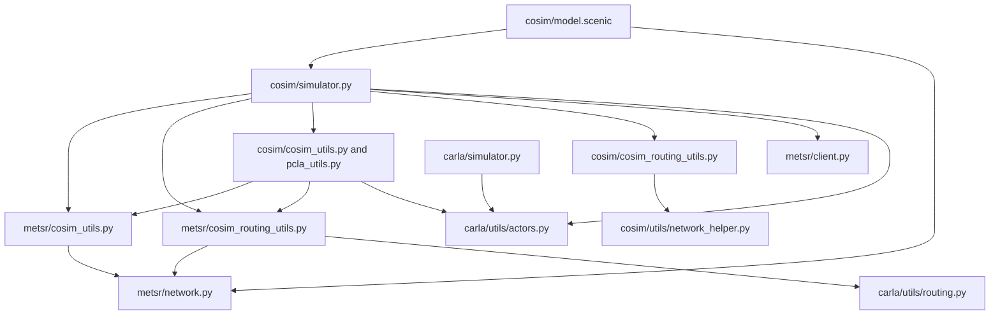

# Reviewing the CARLA-METS-R implementation cleanup

The comparison baseline is [`METSRSim` at `501d83a55a1c741d71186549afdbf481499d5e11`](https://github.com/Kv139/Scenic/tree/501d83a55a1c741d71186549afdbf481499d5e11).
The working tree includes earlier co-simulation behavior fixes and unrelated local changes. This cleanup consolidates shared mechanics, makes state ownership explicit, and preserves the handoff sequence. The intentional validation and controller fixes are listed separately below.

## 1. Start with the dependency direction



`cosim` coordinates CARLA and METS-R. Standalone `metsr`, `carla`, and `gta` remain separate entry points. Native metadata and state/response helpers must import without CARLA or `cosim`. Optional native routing uses CARLA, but importing it must not import the `cosim` package or initialize its simulator module. Shared CARLA actor helpers do not depend on METS-R or the coordinator.

## 2. Read these files in order

| File | What to review |
| --- | --- |
| [cosim/simulator.py](../../src/scenic/simulators/cosim/simulator.py) | Start at `step`, then `_select_bubble_roads`, `synchronize_clients`, the three `_commit_*` vehicle transitions, and `_install_carla_destination_path`. The coordinator owns ordering, actor membership, and direct client calls. |
| [metsr/cosim_utils.py](../../src/scenic/simulators/metsr/cosim_utils.py) | `METSRCosimState`, response identity matching, takeover/release commits, queue admission, pose acknowledgments, and completion validation. Native helpers receive state, clients, IDs, or records explicitly. |
| [metsr/network.py](../../src/scenic/simulators/metsr/network.py) | Immutable `NetworkMetadata`, filtered native lane indices, connector topology, and derived mappings. Verify metadata construction copies its inputs and builds indexes once. |
| [cosim/model.scenic](../../src/scenic/simulators/cosim/model.scenic) | The model loads metadata once, uses it for the mapped spawn region, and passes that object to `CosimSimulator`. Python callers may omit metadata and let the simulator load it. |
| [metsr/cosim_routing_utils.py](../../src/scenic/simulators/metsr/cosim_routing_utils.py) | Explicit state/client geometry queries, shared lane projection, connector matching, spawn/handoff placement, and the pure `BubbleRoadSelection` result. High-level CARLA/native integration still receives the coordinator where it needs both systems. |
| [carla/utils/actors.py](../../src/scenic/simulators/carla/utils/actors.py) | Blueprint fallback and attributes, vehicle dimensions and gear, walker controllers, and actor property conversion shared with standalone CARLA. |
| [carla/utils/routing.py](../../src/scenic/simulators/carla/utils/routing.py) | CARLA waypoint indexing and geometry, including terminal projection and elevation-sensitive connector checks. |
| [cosim/cosim_utils.py](../../src/scenic/simulators/cosim/cosim_utils.py) | Native-pose spawn setup, boundary actors, rendering, route-state cleanup, and final teardown. [pcla_utils.py](../../src/scenic/simulators/cosim/pcla_utils.py) contains PCLA-specific lifecycle adaptation. |
| [cosim/utils/network_helper.py](../../src/scenic/simulators/cosim/utils/network_helper.py) | The remaining Scenic lane cache and connected bubble-road selection. Unused road/intersection lookup machinery has been removed. |
| [metsr/client.py](../../src/scenic/simulators/metsr/client.py) | `_batch_field_values`, `_vehicle_batch_records`, `_resolve_alias`, and `_pose_record`, then their query, initialization, and teleport callers. Wire serialization remains in the client. |

The two `cosim_routing_utils.py` files have distinct responsibilities: `cosim` selects the Scenic bubble; `metsr` reconciles native roads/connectors with CARLA placement and routing. They are not duplicate routing implementations.

## 3. Follow one simulation step

Check this ordering in `CosimSimulation.step`:

1. Select the Scenic road component containing the ego's actual CARLA road layer. Obtain a `BubbleRoadSelection`, then explicitly store its repaired Scenic roads and active native road IDs.
2. Acquire entering native roads and confirm connector ownership.
3. Refresh native boundary obstacles and service departure queues.
4. Promote vehicles and initialize CARLA motion/control before the CARLA tick. Reuse the batched native snapshot while METS-R has not advanced.
5. Refresh default destination paths, advance CARLA, and publish CARLA's actual poses.
6. Validate native acknowledgments before demotion or native ownership changes. Record confirmed completion and remove completed CARLA actors.
7. Release eligible leaving roads, retaining roads needed by occupants or pending admissions.
8. Advance METS-R and refresh the property snapshot for the next step.

Pay particular attention to partial or failed acknowledgments, public/private vehicle ID collisions, queued spawns, split connectors, and zero-coordinate poses. Keep overpasses separated by connected road topology, retain connecting ramps, and use the live actor's height when selecting the ego's layer.

## 4. Check state ownership and lifecycle boundaries

### Shared metadata and per-run state

`NetworkMetadata` copies its input dictionaries and nested collections into read-only mappings, tuples, and frozensets. It owns `lane_mapping`, `lane_indices`, connector topology, signal mappings, and the derived `carla_keys_by_lane`, `roads_by_scenic`, and `scenic_roads_by_native` indexes. A simulation refers to the shared object through `metsr_state.metadata`; it does not rebuild or mutate those indexes for each run. Pickle and deep-copy round trips reconstruct the immutable metadata from its source mappings and rebuild consistent derived indexes.

Ownership, pending admissions, private IDs, authoritative segments, and geometry/query caches remain on each run's `METSRCosimState`. `load_network_metadata` parses once per call; there is no process-wide cache that could hide XML edits. Filtered lane indices must exclude shoulders and preserve road IDs containing underscores. Connector IDs remain opaque server identifiers.

Native centerline and connector query helpers take `(state, client, ...)`. `LaneProjection` shares closest-lane geometry while callers retain eligibility and ownership rules, including split-connector ambiguity and physical destination-fragment checks.

`classify_bubble_roads` returns frozen `BubbleRoadSelection(roads, native_road_ids, entering, leaving)`. It repairs shared Scenic road fragments and deduplicates the selection without changing its input or simulation state. `_select_bubble_roads` applies that result explicitly before acquisition.

### Vehicle transitions and routing

The coordinator's `_commit_promotion`, `_commit_demotion`, and `_commit_retirement` centralize actor-list, flag, admission, and completion bookkeeping. `createObjectInCarla` allocates and initializes the actor without committing ownership. Promotion is committed after actor/control initialization; demotion follows accepted handback and CARLA cleanup. The native and CARLA actor lists remain disjoint, including during ego setup. Retirement records confirmed completion once. Native ownership helpers do not edit CARLA actor lists or destination plans.

`_install_carla_destination_path` selects the native destination, generates the CARLA path, installs it in Traffic Manager, and updates `obj.trajectory` and the default-plan record together. Admission, action handling, and destination refresh use the same operation. `_enable_carla_autopilot` can initialize CARLA control before the promotion flag changes. Explicit Scenic paths and PCLA control retain their existing precedence.

`clear_carla_authoritative_segment` clears native continuity state only. `clear_carla_route_state` combines that with removal of a default CARLA plan, clearing the object's trajectory only when it is still that installed plan.

### Runtime removal and final teardown

Keep runtime ownership transitions separate from final cleanup policy. `destroy_carla_obj` and `remove_bubble_object` enforce runtime restrictions, including the prohibition on demoting or ordinarily destroying a PCLA ego. A failed ownership-critical removal must not be silently committed as a successful transition.

Final `destroy` is guarded against repeated calls and attempts cleanup of all remaining objects, including actors whose initialization failed before promotion. It reports failures while continuing other cleanup, runs registered callbacks before parent actors, and closes sensors/controllers before their actors. PCLA sensor cleanup avoids a duplicate sensor sweep when it succeeds. Native reset/release failure is retained and raised after cleanup when there is no original exception to preserve.

Shared `carla/utils/actors.py` contains actor mechanics, not a common teardown policy. Runtime removal and final teardown choose their own registration checks and exception handling around those mechanics.

## 5. Review API changes and intentional fixes

The public `CosimSimulator` constructor retains its existing arguments and supports optional `network_metadata`. Internal `CosimSimulation` construction receives that metadata object instead of separate mapping dictionaries. Construct native run state with `METSRCosimState(metadata=...)` and read static fields through `state.metadata`.

Private interfaces were simplified rather than retained as forwarding wrappers:

- Per-field XML parsers and native mapping methods on `network_cache` were removed. Native mapping helpers live in `metsr/network.py`.
- `network_cache` no longer exposes unused `_nearest_road`, `_get_intersection`, road/intersection caches, `radius_search_size`, or `network_lane_sections`.
- Native query/projection helpers accept explicit state/client arguments. `get_bubble_intersections` no longer accepts unused `bubble_region`; `generate_carla_destination_trajectory` no longer accepts unused `vehicle_state`.
- `update_bubble_objects` no longer takes unused road/intersection arguments. The obsolete `spawn_guard`, `bubble_roads_by_id`, and duplicate camera-manager field were removed; snapshot readiness is tracked by the existing spawn-property seeds.
- `metsr_trajectory_to_carla` is replaced by `_install_carla_destination_path`, which includes installation/bookkeeping and accepts an optional native snapshot and `target_start`.
- Takeover parsing/commit exchanges the canonical connector records and road associations; controlled physical segments are rebuilt from those records instead of passing a second independently maintained mapping.

The following behavior changes are deliberate:

- Explicit query flag sequences with mismatched lengths now raise `ValueError` before sending a request, instead of silently truncating through `zip`. Scalars still broadcast. Shared request builders apply the same complete-row construction to initialization and pose updates; alias conflicts are validated consistently.
- `index_response_records` matches replies to requested identities and rejects missing, duplicate, or unexpected records. Reordered valid responses are accepted and associated with the correct vehicle. Callers retain operation-specific success policy, including retryable queue admissions and public/private identity distinctions.
- Walker removal uses the object's actual `carlaController`; the previous misspelled controller access is corrected through the shared helper.
- The co-simulation boundary query remains **15 m**. The stale regression expectation of 10 m was corrected; this cleanup does not change that runtime distance.

Missing XML raises `FileNotFoundError` at the metadata loader instead of printing a warning and returning empty mappings. This came from the earlier metadata extraction and remains part of the current interface.

## 6. Compare changes and run checks

From the repository root:

```powershell
git status --short
git diff --ignore-space-at-eol 501d83a55a1c741d71186549afdbf481499d5e11 -- src/scenic/simulators/cosim src/scenic/simulators/metsr src/scenic/simulators/carla
python -m pytest --skip-pegen -q tests/simulators/carla/test_actor_utils.py tests/simulators/cosim tests/simulators/metsr tests/core/test_simulators.py
```

The baseline contains different line endings, so `--ignore-space-at-eol` helps isolate changes. Ordinary `git diff` omits untracked files: inspect new files listed by `git status` as well. Use a Python environment with the project test dependencies and CARLA Python package installed. These unit tests do not require simulator servers.

Start with [native metadata/import tests](../../tests/simulators/metsr/test_network.py), [native response/state tests](../../tests/simulators/metsr/test_cosim_utils.py), [client/identity/immutability contracts](../../tests/simulators/metsr/test_native_contracts.py), and [metadata reuse tests](../../tests/simulators/cosim/test_network_metadata.py). Then review [actor helper tests](../../tests/simulators/carla/test_actor_utils.py), [pure routing-boundary tests](../../tests/simulators/cosim/test_routing_boundaries.py), and the existing admission, ownership, routing, boundary-vehicle, and retirement suites. Import isolation is a separate contract from runtime behavior and has its own tests.

[tests/simulators/cosim/helpers.py](../../tests/simulators/cosim/helpers.py) provides common simulation, response-envelope, and admission doubles. Tests can override the state needed for a scenario instead of maintaining separate large coordinator fixtures. Metadata fixture changes construct a new `NetworkMetadata` (or use `dataclasses.replace`) so derived indexes remain consistent.

The local Windows test setup uses `C:/Users/ALei/anaconda3/envs/carla2/python.exe`, disables automatic pytest plugin loading, puts `src` on `sys.path`, and appends the `gfn` environment's site-packages to locate pytest. A complete project environment can use the simpler command above.

## Validation record

Checked on 2026-09-28:

- Combined command above: **329 passed, 41 subtests passed, 1 existing failure**. All co-simulation, METS-R, and shared actor tests passed.
- The remaining failure is `tests/core/test_simulators.py::test_simulator_set_property`: the unrelated `ast.constant` typo at `src/scenic/syntax/compiler.py:1437`. This cleanup does not edit that compiler file.
- Native metadata/state imports without CARLA or co-simulation; optional native routing imports without co-simulation. These are covered by the combined run.
- Regression coverage includes reordered/incomplete native replies, rejected batch lengths, immutable metadata and pickle/deep-copy support, walker cleanup, pure bubble selection, controller initialization failure, and failed Traffic Manager path installation.
- A differential audit of 3,316 pose-command input cases against the original client methods found identical wire payloads and success/error types. Shared alias diagnostics have some wording differences.
- Changed Python modules and tests pass Pyflakes. Refactored modules/tests are formatted with Black and isort; formatting of the large existing client is limited to the modified functions.

Earlier all-map parser comparisons and model-compilation checks are not being claimed as newly executed for this cleanup.

No live CARLA/METS-R service run has been performed for this cleanup.
